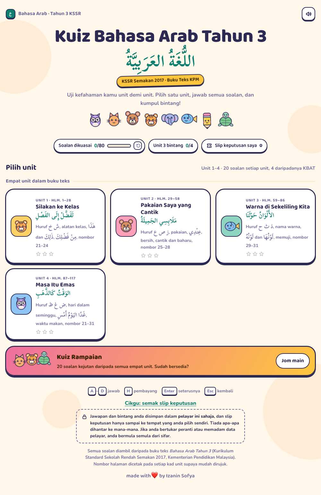
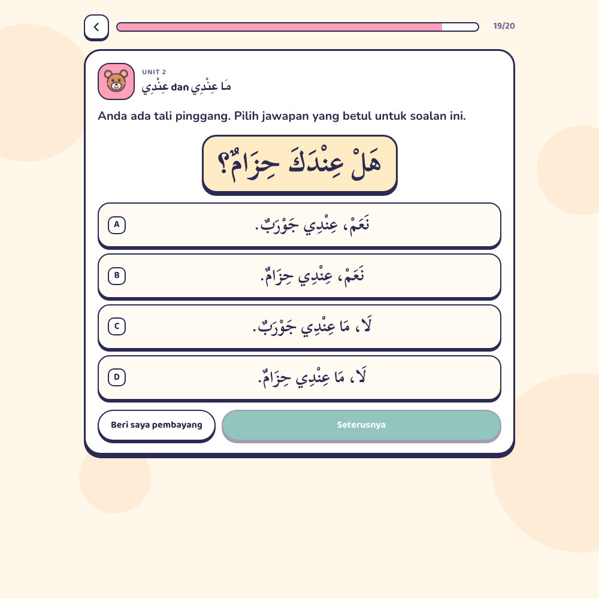

# Kuiz Bahasa Arab Tahun 3

An interactive topical quiz for the Malaysian **Bahasa Arab Tahun 3 (KSSR Semakan 2017)** syllabus, built unit by unit from the Kementerian Pendidikan Malaysia textbook *Bahasa Arab Tahun 3* (Kurikulum Standard Sekolah Rendah). Four units, **20 questions each — 80 in total, of which 16 are KBAT** (Kemahiran Berfikir Aras Tinggi), plus a 20-question Kuiz Rampaian. Everything lives in **one `index.html` file**: no build step, no framework, no npm install, no backend.

The quiz is in Bahasa Melayu with the Arabic set right-to-left and fully vowelled, exactly as the book prints it. Each unit card prints the textbook pages it covers, and every explanation names the page range of its subtopic, so a pupil can find the word in the book.

---

## What's inside

| | |
|---|---|
| **4 units** | One per unit of the textbook, each showing its Arabic title and the pages it covers |
| **80 questions** | 20 per unit, spread across 5–6 subtopics: letters, vocabulary, sentence patterns, numbers |
| **16 KBAT questions** | Four in every unit, marked with a **KBAT** badge: picking the right gender form, spotting the wrong sentence, working out yesterday and tomorrow, sums answered in Arabic |
| **Kuiz Rampaian** | 20 surprise questions drawn from all four units |
| **Arabic that reads properly** | A large right-to-left word or sentence above the options, Arabic answer buttons, blanks in the right place, Scheherazade New with system fallbacks |
| **Hints & explanations** | A hint with a picture on many questions, and a note after you answer saying why it is right, footed with the textbook pages |
| **Eight characters** | Owl, cat, bear, tiger cub (the textbook's own mascot), elephant, fish, pencil and turtle. They blink, bob, cheer when you are right and wobble when you are not |
| **Stars and progress** | Three stars for 90% and above, and a *soalan dikuasai* counter that only goes up when a question is answered correctly without a hint |
| **Result slips** | A plain-text slip with a check code that pupils hand in, and a checker for the teacher (`?check`) |
| **Phone friendly** | One column, big tap targets, checked at 320, 390 and 900 px |
| **Light and dark** | Follows the device theme |
| **Keyboard** | <kbd>A</kbd>–<kbd>D</kbd> to answer, <kbd>H</kbd> for a hint, <kbd>Enter</kbd> for the next question, <kbd>Esc</kbd> to go back |

---

## The four units

| Unit | Buku teks | What it checks |
|---|---|---|
| 🐯 **Unit 1** — Silakan ke Kelas (تَفَضَّلْ إِلَى الفَصْلِ) | hlm. 1–28 | Letters خ ش, classroom objects, هٰذَا / هٰذِهِ / ذٰلِكَ / تِلْكَ, مِنْ فَضْلِكَ and تَفَضَّلْ, numbers 21–24 |
| 🧸 **Unit 2** — Pakaian Saya yang Cantik (مَلَابِسِي الجَمِيلَةُ) | hlm. 29–58 | Letters ع ص ز, clothes, نَظِيفٌ / جَمِيلٌ / جَدِيدٌ, عِنْدِي and مَا عِنْدِي, numbers 25–28 |
| 🐟 **Unit 3** — Warna di Sekeliling Kita (الأَلْوَانُ حَوْلَنَا) | hlm. 59–86 | Letters ح ث ذ, the eleven colours, لَوْنُهُ / لَوْنُهَا, praising and thanking, numbers 29–31 |
| 🦉 **Unit 4** — Masa Itu Emas (الوَقْتُ كَالذَّهَبِ) | hlm. 87–117 | Letters ظ غ ض, days of the week, أَمْسِ / اليَوْمَ / غَدًا, meals, goodbyes, numbers 21–31 |

---

## Run it

Open `index.html` in any modern browser. Nothing else is needed, and it works offline (the rounded fonts fall back to system fonts if they cannot be fetched).

## Check your work: the built-in self-test

Open `index.html?selftest=1`. It checks the whole question bank (four options, a hint, an explanation, no duplicate questions, no hint that gives away the answer, every Arabic word inside a right-to-left span), then drives the page itself: answering, hints, result slips, the teacher checker, the request form, stars and reset. The title bar and a panel at the bottom report `PASS 284/284`.

## Privacy

Answers and stars are stored in **this browser only**. Nothing leaves the device, and result slips go only where the pupil chooses to send them. The "Minta kuiz baharu" request form stays hidden until `REQUEST_URL` near the top of the script is set to an Apps Script address.

## Credits and licence

Questions are based on the Kementerian Pendidikan Malaysia textbook *Bahasa Arab Tahun 3* (KSSR Semakan 2017). Made with ❤️ by Izanin Sofya. MIT licence, see `LICENSE`.
